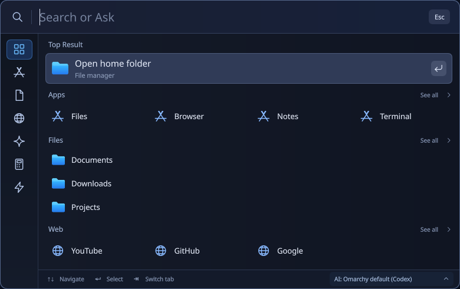
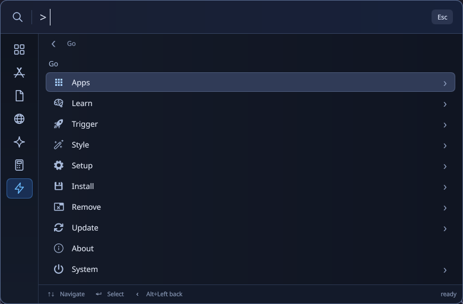

# Spotlight for Omarchy

A compact native launcher for Omarchy Quattro: **Search or Ask** from one keyboard-first panel.



*The preview is captured from the real QML interface with isolated demonstration data—not a user's files or desktop.*

## Features

- Search the complete catalog of visible desktop applications; the Apps category is not limited to the mixed-search result cap.
- Find local files and folders by name using a private on-demand index.
- Calculate expressions locally and copy results with Enter.
- Ask an AI CLI in a terminal. General text selects AI first; no prompt is sent while typing.
- Choose Omarchy's default agent, Hermes, Codex, Claude Code, Gemini CLI, OpenCode, or a trusted custom CLI.
- Search the web or open fixed YouTube/GitHub/Google shortcuts on explicit selection.
- Compact icon rail, category tooltips, grouped results and keyboard navigation.
- Browse and search the complete installed Omarchy menu from **Actions**: Apps, Learn, Trigger, Style, Setup, Install, Remove, Update, About and System, including nested submenus.
- Native breadcrumbs, Back navigation, source icons, conditional availability, current-setting checkmarks and confirmation before disruptive actions.

This is an independent community plugin, not an official Omarchy or AI-provider product.

## Requirements

- Omarchy **4.x / Quattro**, with its Quickshell shell and Lua Hyprland configuration. Older Walker/Waybar-based Omarchy versions are not supported.
- Python **3.10+**, `gio`, `xdg-open`, and `wl-copy` on PATH.
- `omarchy-launch-tui` for terminal AI handoff.
- For AI: at least one separately installed and configured supported CLI, or a trusted custom command. **Hermes is optional.** The plugin does not install CLIs, sign into accounts, change models, or configure API credentials.
- Node.js is needed only to run the JavaScript tests, not for normal plugin use.

The plugin runs unsandboxed as your user, like other Omarchy shell plugins. Review the code before enabling it.

## Install

```sh
omarchy plugin add https://github.com/cynricantao/omarchy-spotlight
omarchy plugin enable io.github.cynricantao.spotlight
```

This adds a search button to the bar. You can move it through Omarchy's bar settings or CLI.

### Optional Alt + Space shortcut

Inspect existing bindings first:

```sh
omarchy menu keybindings --print
```

If Alt + Space is free, add this to `~/.config/hypr/bindings.lua`:

```lua
o.bind("ALT + SPACE", "Spotlight", "omarchy-shell shell toggle io.github.cynricantao.spotlight '{}'")
```

If it is already assigned, choose a different shortcut or explicitly unbind the existing assignment before replacing it. Do not leave a local prototype's duplicate binding active.

```sh
hyprctl reload
hyprctl configerrors
```

No installer writes keyboard bindings or replaces your desktop configuration automatically.

## Use

| Input | Behavior |
|---|---|
| `explain DNS` | Ask AI is the default result; matching local items and Web remain alternatives |
| `app firefox` | Search applications only |
| `file invoice` | Search filenames/folder names only |
| `web linux news` | Search DuckDuckGo in the default browser |
| `? explain DNS` | Explicit AI query |
| `= (42 + 8) / 2` | Local calculator; Enter copies the answer |
| `> ` | Browse the full Omarchy menu without leaving Spotlight |
| `> screenshot` | Search Omarchy menu actions, labels, aliases and paths |

- **Up/Down:** select a result; the results view scrolls to keep it visible.
- **Enter:** activate the selected result. No AI or web action happens merely from typing.
- **Escape:** close.
- **Tab / Shift+Tab:** switch categories.
- **Ctrl+1…7:** All, Apps, Files, Web, AI, Calculate, Actions.
- **Ctrl+Enter:** change the query to AI mode; Enter again submits it.
- **Alt+Enter:** change the query to Web mode; Enter again opens the search.
- **Ctrl+,** or the footer's **AI** button: choose the CLI used by Spotlight.
- In **Actions**, **Enter / Right** opens a submenu. **Alt+Left**, **Backspace** on an empty `> ` query, or the Back button returns to the parent; breadcrumb buttons jump to ancestors. Typing searches descendants of the current submenu. At the root it searches the whole menu, with no mixed-search result cap.
- Destructive/disruptive actions open a confirmation inside Spotlight. **Cancel** is focused initially; Escape cancels. Continue is an explicit second action, not an automatic consequence of pressing Enter on a search result.

The default home view contains actual installed applications and existing indexed folders. It is not a recent-activity feed and does not invent recency timestamps.

### Omarchy menu coverage



*Real native capture of the default root menu; no personal files, prompts or account details are shown.*

Spotlight reads Omarchy's installed `default/omarchy/omarchy-menu.jsonc` and merges your `~/.config/omarchy/extensions/omarchy-menu.jsonc` overrides, matching the standard menu's extension path. It does not bundle a stale copy of the menu or publish your personal extensions. Menu definitions are re-read for queries and activation, so upstream additions and your extensions remain accessible without editing Spotlight. Apps uses the existing complete application catalog; runtime font choices are loaded from Omarchy.

Menu navigation stays in the compact Spotlight panel. Leaf actions use the same Omarchy tools as the standard menu, including their interactive package pickers, configuration editors, authentication and setup dialogs. Spotlight replaces the menu navigation; it does not reimplement those system tools or bypass their own confirmations. Hardware/package conditions can hide entries that do not apply to this computer, just as the standard menu does. Unavailable definitions, malformed extensions, guard failures and unsupported providers are reported rather than disguised as complete results.

Install/removal/update, reset, security/network/boot and power actions require confirmation where applicable. Activation resolves the ID against the current trusted definition, checks availability again and rejects a changed action token rather than executing a command supplied by a result payload. Browsing does not install software, alter networking, reset configuration or run a power action.

Opening Actions does **not** replace the standard Omarchy widget or Super+Space binding automatically. Both can remain as fallbacks; existing Spotlight shortcuts and the seven-category rail are unchanged.

## AI settings

Use the **AI** footer selector. **Omarchy default** follows the agent selected by Omarchy; other choices override it for Spotlight only. Missing executables are identified rather than silently installed or replaced.

The selected CLI keeps its own account, model and permission configuration. The built-in presets add no automatic-approval or sandbox-bypass flags. Login/workspace-trust prompts may require interaction before a CLI processes the first question. Availability on PATH is not proof of authentication or a successful provider connection.

See [AI setup](AI-SETUP.md) for custom argv templates and supported interactive launch forms.

## Privacy and limits

- Search, arithmetic and filename indexing are local. There is no plugin telemetry or automatic AI/web request while typing.
- Menu availability/checkmark discovery evaluates local shell conditions from the trusted installed menu and your own extensions. These are unsandboxed trusted code, not search text; review extensions before adding them. Selecting a leaf action can launch system tools or network operations.
- Selecting Web sends that query to the search engine. Selecting AI hands the query to the chosen CLI, whose own provider, tools, logs and privacy settings apply.
- The plugin stores no query history. Prompts passed to a CLI can appear in the local process argument list; do not put secrets in queries or custom argv configuration.
- File matching is by **filename/folder name**, not file contents or semantic search. Hidden files, symlinks and common generated/dependency directories are excluded.
- The index covers HOME and mounted drives under `/run/media/<user>/`. It refreshes on opening when stale or when mounted roots change; scanning is bounded to 15 seconds or 250,000 names. Coverage and truncation are reported, not silently treated as exhaustive.
- Native arithmetic is supported. **Currency conversion is not included.**

Local data:

| Location | Purpose |
|---|---|
| `$XDG_CACHE_HOME/omarchy-spotlight/` (default `~/.cache/omarchy-spotlight/`) | Private filename index and lock |
| `$XDG_CONFIG_HOME/omarchy/spotlight-ai.json` (default `~/.config/omarchy/spotlight-ai.json`) | Spotlight AI selection and custom argument template |

Storage rejects symlink traversal and unsafe ownership/write permissions rather than changing existing permissions automatically. Resolve an unsafe-path error yourself or choose safe XDG directories; do not make your configuration world-writable.

## Update and remove

```sh
omarchy plugin update io.github.cynricantao.spotlight
omarchy plugin disable io.github.cynricantao.spotlight
omarchy plugin remove io.github.cynricantao.spotlight
```

Remove your optional keybinding separately, then reload and check Hyprland. AI settings and filename-cache paths are separate from the checkout; review them separately if you also want to remove local data.

## Development and verification

```sh
python3 -B -W error::ResourceWarning -m unittest discover -p 'test_*.py' -v
node test_logic.cjs
node test_menu_logic.cjs
omarchy plugin validate .
```

Tests use isolated fixtures for settings, indexing and provider routing. They do not authenticate to an AI provider or prove that every CLI/version works with every account. CLI launch-contract tests, native UI validation, clean-install checks and real provider responses are separate verification layers.

Report reproducible bugs through GitHub issues. Report sensitive vulnerabilities privately; see [SECURITY.md](SECURITY.md).

## License

[MIT](LICENSE). See [THIRD_PARTY_NOTICES.md](THIRD_PARTY_NOTICES.md) for dependency/attribution details. Service and application names belong to their respective owners; no endorsement is implied.
